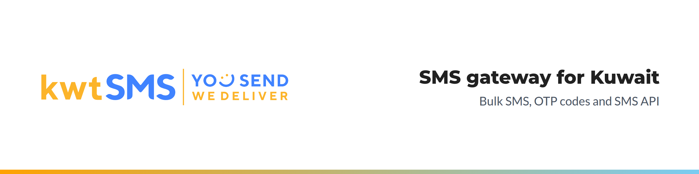

<picture>
  <source media="(prefers-color-scheme: dark)" srcset=".github/assets/readme-header-dark.png">
  
</picture>

# kwtSMS for n8n

[](https://www.npmjs.com/package/n8n-nodes-kwtsms)
[](https://opensource.org/licenses/MIT)
[](https://docs.n8n.io/integrations/community-nodes/)
[](https://github.com/kwtsms/kwtsms-n8n/actions/workflows/codeql.yml)

Send SMS, check your balance, validate numbers and list Sender IDs from your n8n workflows, through kwtSMS, the Kuwaiti
SMS gateway. Free, and a verified community node: available on n8n Cloud since 2026-11-13.

All kwtSMS integrations: [kwtsms.com/integrations](https://www.kwtsms.com/integrations/)

kwtSMS delivers to Zain, Ooredoo, stc and Virgin in Kuwait and to more than 200 countries, with your own Sender ID,
free API testing and credits that do not expire.

## Features

- **Send SMS**: one or many recipients; more than 200 numbers are split into batches of 200, sent with a short delay between them.
- **Message status and delivery report**: look up a sent message by its message ID; delivery reports cover international numbers only.
- **Account**: check balance, list the active country prefixes (coverage).
- **Sender IDs**: list the approved Sender IDs on your account.
- **Validate numbers**: check format and routing before you send.
- **Phone normalization**: strips `+` and `00`, converts Arabic digits, removes duplicates.
- **Message cleaning**: removes emoji, hidden characters and HTML tags before sending.
- **Pre-send checks**: numbers outside your active coverage are skipped; a send stops early when the last known balance is zero.
- **Test mode**: on by default. Messages are queued on kwtSMS and not delivered.
- **Error messages**: all kwtSMS error codes are mapped to plain text.

## Requirements

- n8n 1.0 or later (Cloud or self-hosted), Node.js 18 or later for self-hosted.
- A kwtSMS account (free test account, no papers): https://www.kwtsms.com/cportal/signup/

## Installation

### n8n Cloud

The node is verified: open the nodes panel in your workflow, search for **kwtSMS** and add it. No install needed.

### Self-hosted

1. Go to **Settings > Community Nodes**.
2. Select **Install a community node**.
3. Enter `n8n-nodes-kwtsms`, accept the risks and click **Install**.

Or from the command line, then restart n8n:

```bash
cd ~/.n8n/nodes
npm install n8n-nodes-kwtsms
```

## Setup

1. In n8n, create a **kwtSMS API** credential.
2. Enter the API username and password of your kwtSMS account (not your mobile number; find them under API settings
   in your account) and a default Sender ID.
3. Click **Test** to verify the credential.
4. Add the **kwtSMS** node, choose **SMS > Send**, enter a number as `965XXXXXXXX` and a message, and run it with test
   mode on.
5. Turn test mode off for real sends.

Test mode messages are not delivered, but their credits are held until you delete them from the Sending Queue in your
kwtSMS account.

### Operations

| Resource | Operation | What it does |
|----------|-----------|--------------|
| SMS | Send | Sends a message to one or more recipients. |
| SMS | Get Status | Returns the queue status of a sent message (by message ID). |
| SMS | Get Delivery Report | Returns the delivery report of a sent message. International numbers only; Kuwait numbers have no delivery report. |
| Account | Get Balance | Returns available and purchased credits. |
| Account | Get Coverage | Returns the active country prefixes. |
| Sender | List | Returns the Sender IDs on your account. |
| Validation | Validate Numbers | Returns OK (valid), ER (format error) and NR (no route) lists. |

**Send options** (under *Add Option*):
- **Sender ID**: must be approved on your kwtSMS account. Empty uses the default from the credential.
- **Test Mode**: on by default.

Workflows created before 0.3.0 keep the old fields (node version 1) and behave as before.

### Phone number format

Numbers are normalized before every call: `+965XXXXXXXX`, `00965XXXXXXXX` and `+965 XXXX XXXX` all become
`965XXXXXXXX`, and Arabic digits become Latin digits.

### Common errors

| Code | Meaning |
|------|---------|
| ERR003 | Authentication failed. Check the API username and password. |
| ERR006 | No valid phone numbers provided. |
| ERR010 | Account balance is zero. |
| ERR013 | Send queue is full. Wait a moment and run the step again. |
| ERR028 | Same number too soon. Duplicate protection is opt-in per account; when on, the whole request is rejected and nothing is charged. |

## Arabic

Arabic messages are supported. They are sent as Unicode: one SMS page holds 70 Arabic characters, against 160 English
ones, and a message can have up to 7 pages. Arabic digits in phone numbers are converted automatically. The node
screens themselves are in English.

## FAQ

**Which username do I use?** The API username and password of your kwtSMS account, not your mobile number.

**Why do test messages not arrive?** Test mode queues messages without delivering them. Turn it off in the node options.

**What is a Sender ID?** The name shown as the sender on the phone. See the
[Sender ID help](https://www.kwtsms.com/sender-id-help.html).

## Changelog

See [CHANGELOG.md](CHANGELOG.md).

## Support

Help: https://www.kwtsms.com/support.html | FAQ: https://www.kwtsms.com/faq/ |
API: [developers](https://www.kwtsms.com/developers.html), [API reference](https://www.kwtsms.com/api-documentation.html) |
[Issues](https://github.com/kwtsms/kwtsms-n8n/issues)

## Security

See [SECURITY.md](SECURITY.md).

## License

MIT, (c) kwtSMS (BoxLink Center). See [LICENSE](LICENSE).
